# Dự báo nhu cầu hàng hóa và hỗ trợ quản lý tồn kho

Ứng dụng Machine Learning chạy cục bộ: kiểm tra dữ liệu → EDA → tạo đặc trưng quá khứ →
huấn luyện và tuning → đánh giá test → dự báo → đề xuất nhập hàng. Giao diện Streamlit có
sáu trang tiếng Việt. Các mô hình dự báo dùng scikit-learn; không dùng API mô hình ngôn ngữ lớn.

Dữ liệu [Kaggle Store Sales](https://www.kaggle.com/competitions/store-sales-time-series-forecasting/data)
gồm **3.000.888 dòng, 54 cửa hàng, 33 nhóm hàng**, từ 01/01/2013 đến 15/08/2017.
EDA dùng toàn bộ CSV. Thực nghiệm chính thức dùng **54 cửa hàng × 3 nhóm**
`BEVERAGES`, `GROCERY I`, `PRODUCE`: **162 chuỗi, 272.808 quan sát**.
Phạm vi này được chọn trước khi xem metric để phù hợp máy cá nhân; chưa train đủ 33 nhóm.
Kết quả chính thức nằm ở `results/official` và `models/official`; dữ liệu mô phỏng giữ riêng ở `data/demo`.

## 1. Cài đặt môi trường

Mở terminal tại thư mục gốc dự án. Khuyến nghị Python 3.11; môi trường thực nghiệm đã kiểm tra
là **macOS arm64, Python 3.9.6**. Phiên bản thư viện nằm trong `requirements.txt`;
`requirements-lock.txt` lưu môi trường thực nghiệm để đối chiếu. Phiên bản thực thi cũng được ghi
trong `run_manifest.json`. NumPy 1.26.4 được dùng để tránh cảnh báo số học đã gặp với NumPy 2.0.2
trên máy thử nghiệm.

macOS / Linux:

```bash
python3 -m venv .venv
source .venv/bin/activate
python -m pip install -r requirements.txt
python -m pip check
```

Windows PowerShell:

```powershell
py -3.11 -m venv .venv
.\.venv\Scripts\Activate.ps1
python -m pip install -r requirements.txt
python -m pip check
```

Nếu PowerShell chặn kích hoạt, dùng `.\.venv\Scripts\python.exe` thay cho `python` trong các lệnh sau.
Cần mạng để cài thư viện và tải dữ liệu. Windows/Linux/Python 3.11 chưa được kiểm thử thực tế.

## 2. Chuẩn bị dữ liệu

Đăng nhập Kaggle, chấp thuận điều khoản cuộc thi, tải và giải nén các file vào:

```text
data/raw/train.csv             Bắt buộc: lịch sử bán hàng có nhãn sales
data/raw/stores.csv            Tùy chọn: địa bàn cửa hàng cho EDA ngày lễ
data/raw/holidays_events.csv    Tùy chọn: lịch lễ/sự kiện cho EDA
data/raw/train.metadata.json    Tùy chọn: nguồn và đơn vị dữ liệu đã xác nhận
```

Workspace hiện đã có ba CSV trên. Khi sao chép/clone dự án sang máy khác, cần chuẩn bị lại
vì `data/raw/*.csv` không được lưu trong Git. Xem [hướng dẫn dữ liệu](data/raw/README.md).
Schema bắt buộc: `date,store_nbr,family,sales`; `onpromotion` chỉ dùng cho EDA.
Kaggle `test.csv` không có `sales`, không dùng làm đầu vào lịch sử cho pipeline này.

## 3. Chạy toàn bộ chương trình từ đầu

Sau khi cài đặt, chuẩn bị CSV và kích hoạt `.venv`, chạy lần lượt các lệnh dưới đây tại thư mục gốc.
Đây là **toàn bộ quy trình với phạm vi thực nghiệm chính thức 162 chuỗi**, không dùng `--quick`.
`src.train` tự tạo đặc trưng, chia train/validation/test, train ba thuật toán, tuning, chọn model,
đánh giá và lưu cả model đánh giá lẫn model triển khai.

```bash
# 1. Kiểm tra schema và chất lượng dữ liệu
python -m src.data_processing --data data/raw/train.csv

# 2. Phân tích toàn bộ dữ liệu và xuất biểu đồ HTML
python -m src.eda --data data/raw/train.csv --output results/official --holidays data/raw/holidays_events.csv --stores data/raw/stores.csv

# 3. Huấn luyện, tuning và đánh giá trên test giữ riêng
python -m src.train --data data/raw/train.csv --output results/official --model-dir models/official --horizon 30 --trials 3 --families BEVERAGES "GROCERY I" PRODUCE

# 4. Tính lại metric từ CSV dự báo test đã lưu
python -m src.evaluate --predictions results/official/metrics/test_predictions.csv --output results/official/metrics/recomputed_test.json

# 5. Nạp lại model để tái hiện test; xuất dự báo 7/30 ngày cho toàn bộ chuỗi đã train
python -m src.verify_run --results results/official

# 6. Dự báo riêng cửa hàng 1 / BEVERAGES, kèm metadata nguồn
python -m src.predict --input data/raw/train.csv --model models/official/model.joblib --store 1 --family BEVERAGES --horizon 7 --output results/official/forecast_7_days.csv
python -m src.predict --input data/raw/train.csv --model models/official/model.joblib --store 1 --family BEVERAGES --horizon 30 --output results/official/forecast_30_days.csv

# 7. Sinh báo cáo Markdown từ kết quả thực nghiệm
python -m src.report --results results/official --output docs/bao_cao_giua_ky.md

# 8. Chạy bộ kiểm thử tự động
python -m pytest -q --junitxml=results/metrics/pytest.xml

# 9. Mở giao diện
python -m streamlit run app.py
```

Nếu chỉ có `train.csv`, thay lệnh EDA ở bước 2 bằng:

```bash
python -m src.eda --data data/raw/train.csv --output results/official
```

Mở **http://localhost:8501** và chọn nguồn **CSV người dùng / Kaggle** nếu cần.
Trên trang **Dự báo nhu cầu**, chọn cửa hàng/nhóm hàng đã train và nhấn **Thực hiện dự báo**.
Trang **Quản lý tồn kho** dùng dự báo cùng các giá trị tồn kho người dùng nhập để đề xuất nhập hàng.
Dừng server bằng `Ctrl+C`. Giao diện chỉ nạp model đã train; huấn luyện chạy bằng CLI.

Các lệnh trên ghi vào `results/official`, `models/official` và sinh lại báo cáo Markdown.
Đổi `--output`/`--model-dir` nếu cần giữ riêng lần chạy; các bước sau phải trỏ tới đúng thư mục mới.
Model `.joblib` không được lưu trong Git, cần train lại khi chưa có model trên máy.
Dữ liệu kết thúc 15/08/2017 nên dự báo bắt đầu **16/08/2017**.

### Mở lại khi đã có model và kết quả

macOS / Linux:

```bash
source .venv/bin/activate
python -m streamlit run app.py
```

Windows PowerShell:

```powershell
.\.venv\Scripts\Activate.ps1
python -m streamlit run app.py
```

### Chạy demo bằng dữ liệu mô phỏng (tùy chọn)

Không cần tải dữ liệu hoặc token Kaggle cho demo. Sau khi kích hoạt môi trường, chạy:

```bash
python -m src.demo_data
python -m src.data_processing --data data/demo/sales.csv
python -m src.eda --data data/demo/sales.csv --output results/demo
python -m src.train --data data/demo/sales.csv --output results/demo --model-dir models/demo --quick --trials 3
python -m src.evaluate --predictions results/demo/metrics/test_predictions.csv --output results/demo/metrics/recomputed_test.json
python -m src.predict --input data/demo/sales.csv --model models/demo/model.joblib --store 1 --family BEVERAGES --horizon 30 --output results/demo/forecast_30_days.csv
python -m src.report --results results/demo --output docs/bao_cao_demo.md
python -m pytest -q --junitxml=results/metrics/pytest.xml
python -m streamlit run app.py
```

Mở **http://localhost:8501** và chọn nguồn **Demo mô phỏng**. Giao diện tự chọn nguồn Kaggle
khi có manifest chính thức, nên cần đổi nguồn để xem kết quả demo. Demo lưu riêng trong
`data/demo`, `results/demo`, `models/demo` và `docs/bao_cao_demo.md`.

`--quick` giảm số cây/vòng boosting và mặc định chọn tối đa 12 chuỗi theo khóa sắp xếp;
không cắt ngẫu nhiên số dòng. Các chuỗi đã dùng được ghi trong manifest.

### Huấn luyện toàn bộ 33 nhóm hàng (tùy chọn)

Bỏ các bộ lọc `--stores`, `--families`, `--max-series` và không dùng `--quick` để học cả
**54 × 33 = 1.782 chuỗi**. Lệnh sau lưu riêng; thời gian và RAM cho phạm vi này chưa được đo:

```bash
python -m src.train --data data/raw/train.csv --output results/full_dataset --model-dir models/full_dataset --horizon 30 --trials 3
```

Để đánh giá/kiểm chứng lần này, dùng `--results results/full_dataset` hoặc thay đường dẫn
`results/official`/`models/official` tương ứng ở các lệnh trên; xuất báo cáo ra file riêng.
Giao diện nguồn Kaggle hiện đọc `results/official`, nên vẫn hiển thị lần chạy chính thức.

## 4. Đầu ra và kết quả tham chiếu

| Đường dẫn | Nội dung |
| --- | --- |
| `models/official/evaluation_model.joblib` | Model fit train + validation để tái hiện test |
| `models/official/model.joblib` | Model refit toàn lịch sử sau đánh giá để dự báo mới |
| `results/official/run_manifest.json` | Nguồn, SHA-256, chuỗi đã train, mốc chia và môi trường |
| `results/official/metrics/comparison.csv` | Metric validation/test và thời gian các thuật toán |
| `results/official/metrics/tuning.csv`, `tuning_summary.csv` | Từng cấu hình và so sánh trước/sau tuning |
| `results/official/metrics/verification.json` | Kiểm chứng model nạp lại và dự báo 7/30 ngày |
| `results/official/forecast_{7,30}_days_all_series.csv` | Dự báo toàn bộ 162 chuỗi do `src.verify_run` xuất |
| `results/official/forecast_{7,30}_days.csv` | Dự báo cửa hàng 1 / BEVERAGES do `src.predict` xuất |
| `results/official/figures/` | Biểu đồ EDA, chia thời gian, train, tuning và test; mở HTML bằng trình duyệt |
| `results/official/training.log`, `training_events.jsonl`, `source_snapshot/` | Nhật ký huấn luyện và mã nguồn tại thời điểm chạy |
| `docs/bao_cao_giua_ky.md` | Báo cáo sinh từ kết quả thực nghiệm |
| `results/metrics/pytest.xml` | Kết quả bộ kiểm thử tự động |

Kết quả tham chiếu trên 4.860 quan sát test, lấy từ `results/official/metrics/comparison.csv`.
**Random Forest** được chọn theo validation.

| Thuật toán | MAE test | RMSE test | WAPE test (%) |
| --- | ---: | ---: | ---: |
| Seasonal naive | 517,555 | 899,231 | 14,986 |
| Ridge | 542,383 | 797,537 | 15,705 |
| Random Forest | 445,633 | 692,496 | 12,904 |
| HistGradientBoosting | 476,471 | 732,513 | 13,797 |

MAE là trung bình sai số tuyệt đối; RMSE nhấn mạnh sai số lớn;
WAPE (%) = 100 × tổng sai số tuyệt đối / tổng |sales|. Khi mẫu số bằng 0, WAPE không xác định
(JSON `null`). WAPE gộp thiên về chuỗi sales lớn. MAE/RMSE/WAPE càng thấp càng tốt;
không diễn giải `100 − WAPE` là accuracy.
Thời gian train trong bảng comparison là lần refit train + validation, không gồm tổng tuning.
Suy luận đo xử lý dữ liệu trong bộ nhớ và cả horizon, không gồm đọc CSV/nạp model;
ms/dòng là thời gian batch chia số dòng, không phải độ trễ một yêu cầu đơn lẻ.
Tốc độ phụ thuộc phần cứng và tải máy.

## 5. Quy tắc mô hình và dữ liệu mới

Yêu cầu “thể hiện rõ quá trình train” được đáp ứng bằng mã `.fit(X_train,y_train)`,
mốc train/validation/test, nhật ký từng cấu hình, tham số đầy đủ, loss train chẩn đoán,
bảng tuning và artefact lưu/nạp. Xem [hướng dẫn trình bày bằng chứng](docs/minh_chung_huan_luyen.md)
và mục **8.1–8.2, 9–10** của [báo cáo](docs/bao_cao_giua_ky.md).
Ridge/RF không cần có epoch như mạng nơ-ron. Đồ thị HGB theo vòng boosting dùng số đo thật,
không phải animation hoặc log dựng sẵn.

```mermaid
flowchart LR
    A[CSV lịch sử có sales] --> B[Kiểm tra và sắp ngày]
    B --> C[Train: lag và rolling từ quá khứ]
    C --> D[Ba mô hình + random search]
    D --> E[Recursive validation]
    E --> F[Khóa lựa chọn]
    F --> G[Refit train + validation]
    G --> H[Test giữ riêng]
    H --> I[Refit toàn lịch sử sau đánh giá]
    I --> J[Model triển khai]
    J --> K[Dự báo đệ quy]
    K --> L[CSV và đề xuất nhập hàng]
```



- Chia theo **ngày**, mặc định 30 ngày validation, 30 ngày test; phần trước là train.
  Cần ít nhất `60 + 2 × horizon` ngày; mỗi chuỗi phải có lịch sử đủ dài và cùng ngày chốt.
  Không dùng random train_test_split. Tất cả series của một ngày thuộc cùng một tập.
- Lag 1/7/14/28; rolling mean/std 7/14/28, **shift(1) trước rolling**; lịch ngày/tháng/thứ/cuối tuần,
  chu kỳ sin/cos, trend. Warm-up thiếu feature bị loại. One-hot và scaler chỉ fit trên phần train đang dùng.
- Ngày thiếu được chèn theo lịch, forward fill **chỉ** làm state; đánh dấu is_observed=False,
  không làm nhãn train hoặc ground truth. Sales thật bị thiếu/âm/vô hạn và khóa trùng bị từ chối.
- Không dùng khuyến mãi/dầu/giao dịch/sự kiện tương lai làm feature. EDA vẫn phân tích onpromotion
  và ngày lễ khi có dữ liệu. Mô hình hiện tại chưa học tác động riêng của các biến này.
- Mô hình: **Ridge**, **RandomForestRegressor**, **HistGradientBoostingRegressor**.
  HGB là boosting tích hợp sklearn thay LightGBM/XGBoost để giữ bộ cài gọn.
  **Seasonal naive** lấy lag_7 làm mốc đối chiếu, không có bước fit.
- Tuning dùng **ParameterSampler + vòng recursive validation theo thời gian tự viết**,
  không phải RandomizedSearchCV mặc định trên bảng lag. Có cấu hình gốc và tìm kiếm ngẫu nhiên,
  seed 42. Không gian tham số, mọi lượt thử, kết quả trước/sau đều được lưu.
- Validation/test được dự báo **cả horizon từ một origin**, cập nhật lag bằng dự báo đã sinh.
  Không dùng sales thật bên trong holdout để dự báo các ngày sau. Chặn dự báo âm tại 0.
- Chọn WAPE validation nhỏ nhất, dùng MAE nếu mẫu số bằng 0; hòa điểm ưu tiên tốc độ suy luận.
  Khóa lựa chọn **trước** test. Test đo mọi thuật toán để so sánh cuối cùng, không dùng chọn model.
- `evaluation_model.joblib` fit train+validation dùng tái hiện test.
  `model.joblib` refit toàn bộ lịch sử **sau khi** đánh giá, dùng dự báo mới.
  Không dùng bản refit để tính lại chất lượng trên cùng test.

### Dự báo bằng dữ liệu lịch sử mới

Để dự báo từ lịch sử cập nhật, đặt CSV tại `data/raw/history.csv`, có cùng schema và ít nhất
**28 ngày lịch sử mỗi chuỗi**. Ví dụ dưới đây chỉ minh họa schema hai dòng, chưa đủ lịch sử:

```csv
date,store_nbr,family,sales,onpromotion
2025-01-01,1,BEVERAGES,100.5,0
2025-01-02,1,BEVERAGES,103.0,2
```

Chọn chuỗi đã xuất hiện khi train; dự báo bắt đầu sau ngày cuối đầu vào:

```bash
python -m src.predict --input data/raw/history.csv --model models/official/model.joblib --store 1 --family BEVERAGES --horizon 30 --output results/official/forecast_new.csv
```

Bỏ `--store`/`--family` chỉ khi mọi chuỗi trong CSV đều đã được train và cập nhật cùng ngày cuối.
Đầu ra gồm `date,store_nbr,family,prediction` và sidecar `.metadata.json` ghi nguồn, hash và origin.
Chỉ nạp `.joblib` tin cậy do nhóm tự train, vì joblib dùng cơ chế pickle.

## 6. Giao diện và tồn kho

1. **Tổng quan:** nguồn dữ liệu, số quan sát/cửa hàng/nhóm hàng, xu hướng và model đang nạp.
2. **Phân tích dữ liệu:** chọn cửa hàng/nhóm/ngày, xem xu hướng, thứ/tháng, khuyến mãi và chất lượng dữ liệu.
3. **Dự báo nhu cầu:** chọn chuỗi đã train, 7/30 ngày, nhấn “Thực hiện dự báo”, xem bảng/biểu đồ và tải CSV.
4. **Quản lý tồn kho:** nhập tồn hiện tại, lead time, tồn an toàn, hàng chắc chắn về; xác nhận đơn vị trước tính.
5. **Đánh giá mô hình:** bảng metric validation/test, thời gian thực, tuning và biểu đồ test của model chọn.
6. **Giới thiệu:** mục tiêu, phạm vi và giới hạn.

Đơn vị tính tồn kho phải khớp đơn vị dự báo. Sales tổng nhóm có thể không đồng nhất đơn vị vật lý;
không tự chuyển sang số SKU, thùng hoặc tiền. Demo dùng “đơn vị nhu cầu mô phỏng”.

```text
D_L = tổng dự báo trong L ngày giao hàng
A   = tồn hiện tại + hàng chắc chắn về và có thể sử dụng đúng hạn
T   = D_L + tồn an toàn
Q   = max(0, T - A)
Thiếu theo quy tắc khi A < T; dư theo quy tắc khi A > 2 × T.
```

Nếu lead time vượt horizon, chương trình từ chối thay vì tự kéo dài nhu cầu không có dự báo.
Giữ phần thập phân của Q; chỉ làm tròn lên khi đơn vị thực là rời rạc. Hàng mới đặt có thể chỉ đến
cuối lead time nên Q không đảm bảo tránh mọi thiếu hụt trước khi nhận hàng. Không có tối ưu chi phí
hoặc tự động đặt hàng; đây là quy tắc hỗ trợ quyết định.

## 7. Cấu trúc và artefact

```text
app.py                         Sáu trang Streamlit
src/data_processing.py         Schema, chất lượng, lịch ngày và chia dữ liệu
src/feature_engineering.py     Feature train / inference dùng cùng công thức
src/models.py                  Ba mô hình ML và seasonal naive
src/tuning.py                  Không gian tham số + random search recursive
src/train.py                   Toàn bộ thực nghiệm, refit, lưu/nạp kiểm chứng
src/evaluate.py                Metric, biểu đồ, tái tính test CSV
src/predict.py                 CLI pipeline lịch sử mới → dự báo
src/inventory.py               Công thức tồn kho và kiểm tra đầu vào
src/demo_data.py               Sinh CSV mô phỏng có metadata
src/eda.py                     EDA và ngày lễ theo địa bàn
src/report.py                  Sinh báo cáo tiếng Việt từ kết quả thực
src/training_evidence.py       Nhật ký từng fit, snapshot mã nguồn, đồ thị train/tuning
src/verify_run.py              Tái hiện holdout và kiểm tra suy luận trên CSV thực
src/utils.py                   JSON, SHA-256, metadata nguồn
data/{raw,demo,processed}/     Dữ liệu chính thức, demo và trung gian
models/{demo,official}/        evaluation_model.joblib và model.joblib
results/<nguồn>/               run_manifest.json, forecast_{7,30}_days.csv,
                              forecast_{7,30}_days_all_series.csv (lần chạy official)
                              training.log, training_events.jsonl, source_snapshot/
results/<nguồn>/metrics/       comparison, tuning, tuning_summary, test_predictions,
                              all_models_test_predictions, test_by_series,
                              data_quality, eda, recomputed_test, training_history, verification
results/<nguồn>/figures/       Biểu đồ HTML tương tác, mở cục bộ
results/metrics/pytest.xml     Kết quả kiểm thử thực thi
tests/                        Tiền xử lý, leakage, recursion, E2E, EDA và giao diện
docs/                         Báo cáo, phân công, thuyết trình và nhật ký kiểm thử
```

## 8. Tài liệu, kiểm thử và xử lý lỗi

Mã nguồn pipeline ở `src/`, giao diện ở `app.py`, kiểm thử ở `tests/`.
Đọc [báo cáo](docs/bao_cao_giua_ky.md), [minh chứng huấn luyện](docs/minh_chung_huan_luyen.md),
[kiểm thử](docs/kiem_thu.md), [đối chiếu yêu cầu](docs/doi_chieu_yeu_cau.md),
[thuyết trình](docs/huong_dan_thuyet_trinh.md), [phân công](docs/phan_cong_nhiem_vu.md)
và [nhật ký xây dựng](docs/nhat_ky_build_du_an.md).

```bash
python -m pytest -q --junitxml=results/metrics/pytest.xml
python -m pip check
```

Test tự tạo dữ liệu/artefact trong thư mục tạm, không yêu cầu có model demo sẵn. Có test E2E
train ba thuật toán → tuning → test → lưu/nạp → CSV lịch sử mới → CLI dự báo,
kiểm tra tái hiện holdout bằng evaluation_model và test sáu trang bằng Streamlit AppTest.
Nhật ký xác nhận thực thi nằm ở docs/kiem_thu.md. AppTest không thay kiểm tra hình ảnh trong trình duyệt.

Kết quả đã lưu tại `results/metrics/pytest.xml`: **41 passed**, 0 failures, 0 errors, 0 skipped.
Kiểm chứng model nạp lại và dự báo 7/30 ngày nằm ở `results/official/metrics/verification.json`;
kiểm chứng AppTest trên CSV thật nằm ở `results/official/metrics/app_verification.json`.

| Hiện tượng | Cách xử lý |
| --- | --- |
| `ModuleNotFoundError` | Kích hoạt đúng `.venv`, cài `requirements.txt` |
| Chưa có model | Chạy bước train với đúng `results/official` và `models/official` |
| Thiếu `sales` | Dùng lịch sử có nhãn, không dùng Kaggle `test.csv` |
| Ngày/khóa/sales không hợp lệ | Sửa dữ liệu tại nguồn theo thông báo kiểm tra |
| Không đủ ngày chia tập | Bổ sung lịch sử thật hoặc chọn chuỗi đủ dài |
| Cửa hàng/nhóm chưa train | Chọn chuỗi trong manifest hoặc train lại có chuỗi đó |
| Chuỗi chưa cập nhật cùng ngày | Cập nhật lịch sử hoặc dự báo từng chuỗi bằng bộ lọc |
| `verify_run` báo CSV đã đổi | Dùng đúng CSV của lần train hoặc train lại với dữ liệu mới |
| Chưa tính được tồn kho | Xác nhận cùng đơn vị; kiểm tra số không âm và lead time ≤ horizon |
| Lead time vượt chân trời | Chọn 30 ngày hoặc dùng CLI với horizon phù hợp |
| Chạy Kaggle toàn bộ chậm | Dùng --quick --max-series 12 hoặc giới hạn --stores/--families |
| Cổng 8501 đã dùng | Thêm --server.port 8502 vào lệnh streamlit |
| Cảnh báo không đọc được số lõi vật lý ở sandbox macOS | joblib tự dùng số lõi logic; RF và native pool đã được giới hạn 1; không làm đổi dữ liệu/metric |
| Model tạo bởi phiên bản thư viện khác | Cài đúng requirements.txt và train lại, không nạp artefact không rõ nguồn |

Giới hạn còn lại: chỉ train 3/33 nhóm hàng ở 54 cửa hàng, chưa có rolling-origin nhiều mùa,
chưa khoảng dự báo, chưa kiểm thử RAM/tốc độ khi train toàn bộ 1.782 chuỗi,
chưa đánh giá độ chính xác cấp SKU hay chi phí tồn kho thực.
