# Dự báo nhu cầu hàng hóa và hỗ trợ quản lý tồn kho

Dự án Machine Learning chạy cục bộ: EDA → xử lý dữ liệu → tạo đặc trưng quá khứ →
train / validation / test theo thời gian → random search → lựa chọn mô hình →
dự báo nhiều bước → đề xuất nhập hàng. Giao diện Streamlit gồm sáu trang, bằng tiếng Việt.
Không dùng API mô hình ngôn ngữ lớn cho bài toán dự báo.

**Dữ liệu thực đã có:** `data/raw/train.csv` gồm **3.000.888 dòng**, 54 cửa hàng, 33 nhóm hàng,
từ 01/01/2013 đến 15/08/2017. Có thêm stores.csv và holidays_events.csv.
EDA chạy trên toàn bộ CSV; thực nghiệm ML chính thức dùng **toàn bộ 54 cửa hàng × 3 nhóm**
`BEVERAGES`, `GROCERY I`, `PRODUCE`: **162 chuỗi, 272.808 quan sát**.
Phạm vi này được chọn trước khi xem metric để phù hợp máy cá nhân; chưa train cả 33 nhóm.
Kết quả chính thức nằm ở results/official và models/official. Dữ liệu mô phỏng vẫn giữ riêng ở data/demo.

Mô hình chọn theo validation: **Random Forest**. Test giữ riêng 4.860 quan sát:

| Thuật toán | MAE test | RMSE test | WAPE test (%) |
| --- | ---: | ---: | ---: |
| Seasonal naive | 517,555 | 899,231 | 14,986 |
| Ridge | 542,383 | 797,537 | 15,705 |
| Random Forest | 445,633 | 692,496 | 12,904 |
| HistGradientBoosting | 476,471 | 732,513 | 13,797 |

Nguồn: results/official/metrics/comparison.csv. Đã tái hiện test từ model nạp lại,
kiểm tra dự báo 7/30 ngày và giao diện AppTest trên CSV thật; bộ test tự động **41/41 passed**.


Để mở kết quả đã train, chỉ cần kích hoạt .venv và chạy `python -m streamlit run app.py`.
Giao diện tự chọn nguồn Kaggle khi có manifest chính thức. Dữ liệu kết thúc năm 2017, nên dự báo mới
bắt đầu **16/08/2017**, không phải dự báo cho ngày hiện tại năm 2026.

## 1. Cài đặt

Khuyến nghị **Python 3.11**; môi trường đã thực thi là macOS arm64, **Python 3.9.6**.
Các thư viện trực tiếp cố định trong requirements.txt; phiên bản thực thi ghi trong run_manifest.json.
requirements-lock.txt lưu toàn bộ môi trường đã cài để đối chiếu phụ thuộc gián tiếp.
Chưa kiểm thử trên Windows/Linux hoặc Python 3.11. NumPy 1.26.4 được dùng để tránh cảnh báo
số học gặp ở NumPy 2.0.2 trên máy thử nghiệm.

Mở terminal trong thư mục gốc dự án.

macOS / Linux:

```bash
python3 -m venv .venv
source .venv/bin/activate
python -m pip install -r requirements.txt
```

Windows PowerShell:

```powershell
py -3.11 -m venv .venv
.\.venv\Scripts\Activate.ps1
python -m pip install -r requirements.txt
```

Nếu PowerShell chặn kích hoạt, dùng trực tiếp `.\.venv\Scripts\python.exe` thay cho `python`
ở các lệnh sau, hoặc dùng Command Prompt với `.venv\Scripts\activate.bat`.
Không cần token Kaggle để chạy demo. Cần kết nối mạng khi cài thư viện lần đầu.

## 2. Chạy demo từ đầu

Sau khi kích hoạt môi trường, chạy theo thứ tự:

```bash
python -m src.demo_data
python -m src.data_processing --data data/demo/sales.csv
python -m src.eda --data data/demo/sales.csv --output results/demo
python -m src.train --data data/demo/sales.csv --output results/demo --model-dir models/demo --quick --trials 3
python -m src.evaluate --predictions results/demo/metrics/test_predictions.csv --output results/demo/metrics/recomputed_test.json
python -m src.predict --input data/demo/sales.csv --model models/demo/model.joblib --store 1 --family BEVERAGES --horizon 30 --output results/demo/forecast_30_days.csv
python -m src.report --results results/demo --output docs/bao_cao_demo.md
python -m pytest -q --junitxml=results/metrics/pytest.xml
python -m streamlit run app.py
```

Mở `http://localhost:8501`. Dừng server bằng Ctrl+C. Huấn luyện không chạy trong giao diện.
Nếu dùng sẵn artefact bàn giao, chỉ cần cài thư viện và chạy lệnh Streamlit.
Mỗi lần train cùng thư mục sẽ thay các artefact/kết quả lần trước; đổi --output và --model-dir
để lưu nhiều lần thực nghiệm. Model .joblib bị loại khỏi Git; có thể tái tạo bằng lệnh train.

## 3. Dataset Kaggle chính thức

1. Đăng nhập [Store Sales – Time Series Forecasting](https://www.kaggle.com/competitions/store-sales-time-series-forecasting/data),
   chấp thuận điều khoản và tải dữ liệu.
2. Giải nén `train.csv` vào `data/raw/train.csv`. Có thể đặt thêm `stores.csv`,
   `holidays_events.csv` để EDA ngày lễ. Không cần các tệp bổ sung để train phiên bản hiện tại.
3. Đọc [hướng dẫn dữ liệu](data/raw/README.md); thêm train.metadata.json nếu đã xác nhận nguồn/đơn vị.
4. Kiểm tra CSV **thực tải về**, rồi chạy:

```bash
python -m src.data_processing --data data/raw/train.csv
python -m src.eda --data data/raw/train.csv --output results/official --holidays data/raw/holidays_events.csv --stores data/raw/stores.csv
python -m src.train --data data/raw/train.csv --output results/official --model-dir models/official --horizon 30 --trials 3 --families BEVERAGES 'GROCERY I' PRODUCE
python -m src.evaluate --predictions results/official/metrics/test_predictions.csv --output results/official/metrics/recomputed_test.json
python -m src.predict --input data/raw/train.csv --model models/official/model.joblib --store 1 --family BEVERAGES --horizon 30 --output results/official/forecast_30_days.csv
python -m src.verify_run --results results/official
python -m src.report --results results/official --output docs/bao_cao_giua_ky.md
```

Lệnh EDA có --holidays/--stores chỉ chạy khi các tệp đó tồn tại; nếu chỉ có train.csv,
bỏ hai tùy chọn này. Lệnh predict minh họa cửa hàng 1 / BEVERAGES; phải chọn chuỗi có
trong `results/official/run_manifest.json` sau khi train. Lệnh train chính thức ở trên không dùng quick,
và học ba nhóm ở cả 54 cửa hàng. PowerShell có thể dùng `"GROCERY I"` thay cho `'GROCERY I'`.

Train nhiều chuỗi hơn hoặc đầy đủ (tốn RAM/thời gian hơn; chưa đo trên toàn Kaggle):

```bash
python -m src.train --data data/raw/train.csv --output results/official --model-dir models/official --trials 10 --stores 1 2 --families BEVERAGES PRODUCE
```

Bỏ --stores/--families và không dùng --quick/--max-series để chạy toàn bộ.
Quick giảm số cây/vòng boosting và mặc định chọn tối đa 12 chuỗi theo khóa sắp xếp;
**không** giới hạn số dòng bằng cách cắt ngẫu nhiên. Các chuỗi được dùng được ghi trong manifest.
Để demo Kaggle trên giao diện, chọn nguồn “CSV người dùng / Kaggle”.

Theo mô tả Kaggle, train chứa `date, store_nbr, family, sales, onpromotion` và mã `id`;
sales là tổng bán của nhóm hàng/cửa hàng/ngày và có thể có phần thập phân.
Phần mềm kiểm tra schema của CSV tại runtime, không tự tạo cột tồn kho.
Kaggle `test.csv` không có nhãn sales, **không** truyền file này cho pipeline đọc lịch sử.
Holdout đánh giá nội bộ là hai khoảng thời gian cuối của train.csv có nhãn.

## 4. Pipeline và đánh giá tránh leakage

Yêu cầu “thể hiện rõ quá trình train” được đáp ứng bằng mã `.fit(X_train,y_train)`,
mốc train/validation/test, nhật ký từng cấu hình, tham số đầy đủ, loss train chẩn đoán,
bảng tuning và artefact lưu/nạp. Xem [hướng dẫn trình bày bằng chứng](docs/minh_chung_huan_luyen.md)
và mục **8.1–8.2, 9–10** của [báo cáo](docs/bao_cao_giua_ky.md).
Ridge/RF không cần có epoch như mạng nơ-ron. Đồ thị HGB theo vòng boosting dùng số đo thật,
không phải animation hoặc log dựng sẵn.

```mermaid
flowchart LR
    A[CSV lịch sử có sales] --> B[Kiểm tra và sắp ngày]
    B --> C[Train: lag và rolling từ quá khứ]
    C --> D[Ba mô hình + random search]
    D --> E[Recursive validation]
    E --> F[Khóa lựa chọn]
    F --> G[Refit train + validation]
    G --> H[Test giữ riêng]
    H --> I[Refit toàn lịch sử sau đánh giá]
    I --> J[Model triển khai]
    J --> K[Dự báo đệ quy]
    K --> L[CSV và đề xuất nhập hàng]
```



- Chia theo **ngày**, mặc định 30 ngày validation, 30 ngày test; phần trước là train.
  Cần ít nhất `60 + 2 × horizon` ngày; mỗi chuỗi phải có lịch sử đủ dài và cùng ngày chốt.
  Không dùng random train_test_split. Tất cả series của một ngày thuộc cùng một tập.
- Lag 1/7/14/28; rolling mean/std 7/14/28, **shift(1) trước rolling**; lịch ngày/tháng/thứ/cuối tuần,
  chu kỳ sin/cos, trend. Warm-up thiếu feature bị loại. One-hot và scaler chỉ fit trên phần train đang dùng.
- Ngày thiếu được chèn theo lịch, forward fill **chỉ** làm state; đánh dấu is_observed=False,
  không làm nhãn train hoặc ground truth. Sales thật bị thiếu/âm/vô hạn và khóa trùng bị từ chối.
- Không dùng khuyến mãi/dầu/giao dịch/sự kiện tương lai làm feature. EDA vẫn phân tích onpromotion
  và ngày lễ khi có dữ liệu. Mô hình hiện tại chưa học tác động riêng của các biến này.
- Mô hình: **Ridge**, **RandomForestRegressor**, **HistGradientBoostingRegressor**.
  HGB là boosting tích hợp sklearn thay LightGBM/XGBoost để giữ bộ cài gọn.
  **Seasonal naive** lấy lag_7 làm mốc đối chiếu, không có bước fit.
- Tuning dùng **ParameterSampler + vòng recursive validation theo thời gian tự viết**,
  không phải RandomizedSearchCV mặc định trên bảng lag. Có cấu hình gốc và tìm kiếm ngẫu nhiên,
  seed 42. Không gian tham số, mọi lượt thử, kết quả trước/sau đều được lưu.
- Validation/test được dự báo **cả horizon từ một origin**, cập nhật lag bằng dự báo đã sinh.
  Không dùng sales thật bên trong holdout để dự báo các ngày sau. Chặn dự báo âm tại 0.
- Chọn WAPE validation nhỏ nhất, dùng MAE nếu mẫu số bằng 0; hòa điểm ưu tiên tốc độ suy luận.
  Khóa lựa chọn **trước** test. Test đo mọi thuật toán để so sánh cuối cùng, không dùng chọn model.
- `evaluation_model.joblib` fit train+validation dùng tái hiện test.
  `model.joblib` refit toàn bộ lịch sử **sau khi** đánh giá, dùng dự báo mới.
  Không dùng bản refit để tính lại chất lượng trên cùng test.

Metric: MAE = trung bình sai số tuyệt đối; RMSE nhấn mạnh sai số lớn; WAPE (%) =
100 × tổng sai số tuyệt đối / tổng |sales|. Khi mẫu số 0, WAPE không xác định (JSON null).
WAPE gộp thiên về chuỗi sales lớn. Thấp hơn tốt hơn, không gọi 100 − WAPE là “accuracy”.

Thời gian train trong comparison.csv là lần refit train+validation; tổng tuning nằm trong từng
lượt tuning và tổng run. Suy luận đo cả chuẩn hóa/kiểm tra dữ liệu **trong bộ nhớ**, tạo đặc trưng
và toàn bộ horizon recursive, không gồm đọc CSV từ đĩa/nạp joblib. Số ms/dòng là thời gian batch
chia số dòng, không phải độ trễ một yêu cầu đơn lẻ. Tốc độ phụ thuộc phần cứng/tải máy.

## 5. Dự báo bằng dữ liệu lịch sử mới

Chuẩn bị một CSV chứa **sales đã quan sát**, không phải hàng tương lai chưa có nhãn:

```csv
date,store_nbr,family,sales,onpromotion
2025-01-01,1,BEVERAGES,100.5,0
2025-01-02,1,BEVERAGES,103.0,2
```

Đây chỉ là ví dụ schema hai dòng; pipeline cần **ít nhất 28 ngày lịch sử** cho mỗi chuỗi.
Các ngày thiếu trong khoảng được xử lý theo quy tắc đã nêu. Không có missing sales trên dòng đã tồn tại.
Mỗi chuỗi phải đã xuất hiện khi train và phải cập nhật cùng ngày cuối nếu dự báo chung một batch.
Kết quả bắt đầu từ ngày sau quan sát cuối của CSV đầu vào, không mặc định lấy ngày hiện tại.

```bash
python -m src.predict --input data/demo/sales.csv --model models/demo/model.joblib --horizon 7 --output results/demo/forecast_new.csv
```

Có thể thêm --store và --family. Đầu ra gồm date, store_nbr, family, prediction;
sidecar .metadata.json ghi nguồn lịch sử/model, SHA-256, origin và giả định.
Chỉ nạp .joblib đáng tin cậy do nhóm tự train, vì joblib dùng cơ chế pickle.

## 6. Sử dụng giao diện và tồn kho

1. **Tổng quan:** nguồn dữ liệu, số quan sát/cửa hàng/nhóm hàng, xu hướng và model đang nạp.
2. **Phân tích dữ liệu:** chọn cửa hàng/nhóm/ngày, xem xu hướng, thứ/tháng, khuyến mãi và chất lượng dữ liệu.
3. **Dự báo nhu cầu:** chọn chuỗi đã train, 7/30 ngày, nhấn “Thực hiện dự báo”, xem bảng/biểu đồ và tải CSV.
4. **Quản lý tồn kho:** nhập tồn hiện tại, lead time, tồn an toàn, hàng chắc chắn về; xác nhận đơn vị trước tính.
5. **Đánh giá mô hình:** bảng metric validation/test, thời gian thực, tuning và biểu đồ test của model chọn.
6. **Giới thiệu:** mục tiêu, phạm vi và giới hạn.

Đơn vị tính tồn kho phải khớp đơn vị dự báo. Sales tổng nhóm có thể không đồng nhất đơn vị vật lý;
không tự chuyển sang số SKU, thùng hoặc tiền. Demo dùng “đơn vị nhu cầu mô phỏng”.

```text
D_L = tổng dự báo trong L ngày giao hàng
A   = tồn hiện tại + hàng chắc chắn về và có thể sử dụng đúng hạn
T   = D_L + tồn an toàn
Q   = max(0, T - A)
Thiếu theo quy tắc khi A < T; dư theo quy tắc khi A > 2 × T.
```

Nếu lead time vượt horizon, chương trình từ chối thay vì tự kéo dài nhu cầu không có dự báo.
Giữ phần thập phân của Q; chỉ làm tròn lên khi đơn vị thực là rời rạc. Hàng mới đặt có thể chỉ đến
cuối lead time nên Q không đảm bảo tránh mọi thiếu hụt trước khi nhận hàng. Không có tối ưu chi phí
hoặc tự động đặt hàng; đây là quy tắc hỗ trợ quyết định.

## 7. Cấu trúc và artefact

```text
app.py                         Sáu trang Streamlit
src/data_processing.py         Schema, chất lượng, lịch ngày và chia dữ liệu
src/feature_engineering.py     Feature train / inference dùng cùng công thức
src/models.py                  Ba mô hình ML và seasonal naive
src/tuning.py                  Không gian tham số + random search recursive
src/train.py                   Toàn bộ thực nghiệm, refit, lưu/nạp kiểm chứng
src/evaluate.py                Metric, biểu đồ, tái tính test CSV
src/predict.py                 CLI pipeline lịch sử mới → dự báo
src/inventory.py               Công thức tồn kho và kiểm tra đầu vào
src/demo_data.py               Sinh CSV mô phỏng có metadata
src/eda.py                     EDA và ngày lễ theo địa bàn
src/report.py                  Sinh báo cáo tiếng Việt từ kết quả thực
src/training_evidence.py       Nhật ký từng fit, snapshot mã nguồn, đồ thị train/tuning
src/verify_run.py              Tái hiện holdout và kiểm tra suy luận trên CSV thực
src/utils.py                   JSON, SHA-256, metadata nguồn
data/{raw,demo,processed}/     Dữ liệu chính thức, demo và trung gian
models/{demo,official}/        evaluation_model.joblib và model.joblib
results/<nguồn>/               run_manifest.json, forecast_7_days.csv
                              training.log, training_events.jsonl, source_snapshot/
results/<nguồn>/metrics/       comparison, tuning, tuning_summary, test_predictions,
                              all_models_test_predictions, test_by_series,
                              data_quality, eda, recomputed_test, training_history, verification
results/<nguồn>/figures/       Biểu đồ HTML tương tác, mở cục bộ
results/metrics/pytest.xml     Kết quả kiểm thử thực thi
tests/                        Tiền xử lý, leakage, recursion, E2E, EDA và giao diện
docs/                         Báo cáo, phân công, thuyết trình và nhật ký kiểm thử
```

Xem [báo cáo](docs/bao_cao_giua_ky.md), [phân công](docs/phan_cong_nhiem_vu.md),
[hướng dẫn thuyết trình](docs/huong_dan_thuyet_trinh.md) và [kiểm thử](docs/kiem_thu.md).
Có [bảng đối chiếu yêu cầu và bằng chứng](docs/doi_chieu_yeu_cau.md) để kiểm tra trước khi nộp.
Xem [nhật ký build dự án](docs/nhat_ky_build_du_an.md) để tra cứu từng đầu việc, mô tả, output và các mốc thực nghiệm.
Không tự điền tên hoặc phần đóng góp chưa được xác nhận.

## 8. Kiểm thử và lỗi thường gặp

```bash
python -m pytest -q --junitxml=results/metrics/pytest.xml
python -m pip check
```

Test tự tạo dữ liệu/artefact trong thư mục tạm, không yêu cầu có model demo sẵn. Có test E2E
train ba thuật toán → tuning → test → lưu/nạp → CSV lịch sử mới → CLI dự báo,
kiểm tra tái hiện holdout bằng evaluation_model và test sáu trang bằng Streamlit AppTest.
Nhật ký xác nhận thực thi nằm ở docs/kiem_thu.md. AppTest không thay kiểm tra hình ảnh trong trình duyệt.

| Hiện tượng | Cách xử lý |
| --- | --- |
| ModuleNotFoundError | Dùng đúng .venv; chạy python -m pip install -r requirements.txt |
| Chưa có model | Chạy src.train với --output/--model-dir khớp nguồn đã chọn trong giao diện |
| CSV thiếu sales | Dùng train.csv hoặc lịch sử đã biết nhãn, không dùng test.csv Kaggle |
| Ngày/khóa/sales sai | Sửa tại nguồn; không xóa tùy tiện để lệnh chạy qua |
| Không đủ ngày chia tập | Cần 60 + 2 × horizon ngày và đủ lịch sử theo từng chuỗi |
| Chuỗi chưa cập nhật cùng ngày | Bổ sung quan sát thật hoặc dự báo từng chuỗi riêng bằng bộ lọc |
| Cửa hàng/nhóm hàng chưa train | Chọn chuỗi trong run_manifest.json hoặc huấn luyện lại có chuỗi đó |
| Lead time vượt chân trời | Chọn 30 ngày hoặc dùng CLI với horizon phù hợp |
| Không tính tồn kho | Xác nhận đã quy đổi cùng đơn vị, kiểm tra số không âm |
| Chạy Kaggle toàn bộ chậm | Dùng --quick --max-series 12 hoặc giới hạn --stores/--families |
| Cổng 8501 đã dùng | Thêm --server.port 8502 vào lệnh streamlit |
| Cảnh báo không đọc được số lõi vật lý ở sandbox macOS | joblib tự dùng số lõi logic; RF và native pool đã được giới hạn 1; không làm đổi dữ liệu/metric |
| Model tạo bởi phiên bản thư viện khác | Cài đúng requirements.txt và train lại, không nạp artefact không rõ nguồn |

Giới hạn còn lại: chỉ train 3/33 nhóm hàng ở 54 cửa hàng, chưa có rolling-origin nhiều mùa,
chưa khoảng dự báo, chưa kiểm thử RAM/tốc độ khi train toàn bộ 1.782 chuỗi,
chưa đánh giá độ chính xác cấp SKU hay chi phí tồn kho thực.
